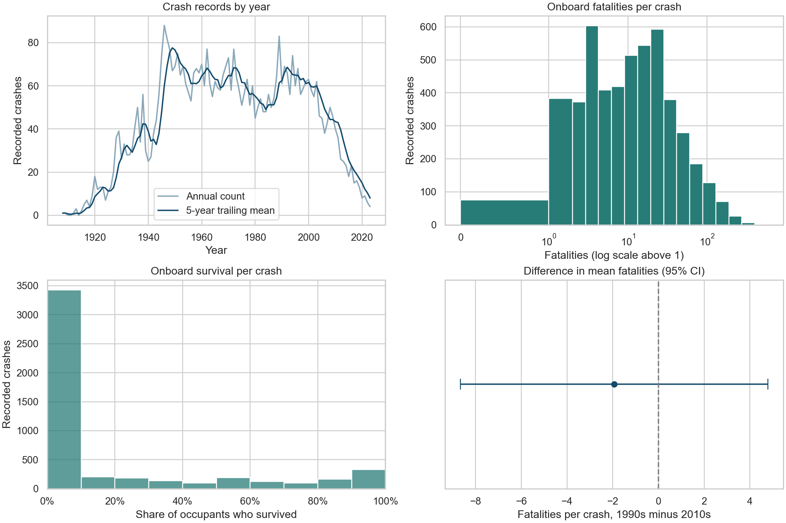

# Analysis of Airplane Crashes and Fatalities

[Developers Institute course dataset](https://github.com/devtlv/Datasets-DA-Bootcamp-2-/blob/main/W4%20Gen%20AI/W4D3/Airplane%20Crashes%20and%20Fatalities%20upto%202023.zip) · [Python solution](airplane_crash_analysis.py)

## Data preparation

The source contains 4,998 rows. After removing 0
exact duplicates, 4,998 crash records remained, covering
September 17, 1908 through November 01, 2023.
0 records had an invalid or missing date.
After numeric conversion, 18 records lacked
a valid onboard count and 8 lacked a valid
onboard fatality count. Missing counts were left unknown.
Survival calculations used 4,975 records with positive occupancy
and a known onboard death count no larger than occupancy.

## Exploratory analysis

- **Known onboard fatalities:** 111,644 across 4,990 records with known counts.
- **Known ground fatalities:** 8,520 across 4,956 records with known ground counts.
- **Known onboard survivors:** 43,795 out of 155,356 occupants in records eligible for survival calculations. The pooled onboard survival rate was **28.2%**.
- **Peak recorded year:** 1946, with 88 crashes. The dataset contains 631 records in the 1990s and 235 in the 2010s. The last year is partial.

| Outcome | Eligible crashes | Mean | Median | Sample standard deviation |
| --- | ---: | ---: | ---: | ---: |
| Onboard fatalities per crash | 4,990 | 22.37 | 11 | 35.06 |
| Onboard survival rate per crash | 4,975 | 18.1% | 0.0% | 31.2 percentage points |

Recorded crashes rose through the early decades, peaked in 1946, and trended downward after the early 1990s. The five-year trailing average shows the decline beyond year-to-year fluctuations.

The mean fatality count exceeds the median, reflecting a long right tail.
In 3,177 eligible records nobody aboard
survived. In 70 everyone aboard survived.
The pooled rate gives each occupant equal weight, while the mean of crash-level
rates gives each crash equal weight.

## Hypothesis test

A two-sided Welch t-test compared mean onboard fatalities in the 1990s and
2010s. Those complete decades let us compare earlier and later records without
including the partial 2020s. Welch's test allows different group variances.

- **1990s:** 631 crashes with known counts, averaging 25.33 fatalities.
- **2010s:** 235 crashes with known counts, averaging 27.26 fatalities.
- **Difference (1990s minus 2010s):** -1.93 fatalities per crash, with a 95% confidence interval from -8.66 to 4.79.
- **Test result:** t = -0.565, df = 385.0, p = 0.5723. The comparison gives insufficient evidence of different means at the 5% level.

The comparison assumes independent records. Extreme crashes can influence
the mean, and missing fatality counts or changing coverage and aircraft mix
can affect comparisons. The dataset gives counts of recorded crashes. Estimating
crash risk over time would also require flight exposure, such as annual departures.

## Visualizations and reproducibility

Pandas imported and cleaned the CSV and grouped crashes by year and decade.
NumPy calculated means and built plot bins. SciPy calculated medians, sample
standard deviations, and the Welch test with its confidence interval.
Matplotlib and Seaborn generated the charts. Run the linked Python script
with the course ZIP beside it to regenerate this report and its figure.
